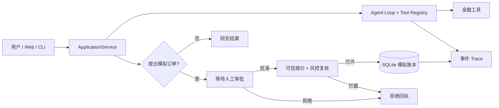

# FinGuard｜金融研究 Agent 与可审计的模拟交易工作台

[简体中文](README.md) · [English](README_EN.md) · [在线交互演示](https://lifee3421.github.io/FinGuard/)

**让金融 AI 的研究过程可观察、可追溯，并将交易决策权保留给人。**

FinGuard 是一个独立设计与开发的金融研究 Agent 原型。用户提出研究问题后，Agent 可以调用行情、公司事件和技术指标等工具，并记录完整执行过程；涉及模拟交易时，系统要求人工审批，并在模拟记账前再次执行确定性风控校验。

> **先体验，再看代码：** 在线版直接展示原始 FinGuard Research Studio 界面，免登录、免配置，使用预设合成数据。它是可交互的**静态产品演示**，并未运行 Python 后端或实时调用大模型。当前仓库的 Python 代码可在本地运行真实模型工具调用；项目不连接券商，也不执行真实交易。

## 产品预览

[](https://lifee3421.github.io/FinGuard/)

[▶ 打开在线 Demo（自动播放约 47 秒产品导览）](https://lifee3421.github.io/FinGuard/) · [▶ 查看约 16 秒的操作演示 GIF](docs/media/ui-walkthrough.gif)

在线 Demo 首次进入会自动依次展示研究问题、并发工具、技术 Trace、证据档案、人工审批与风控案例；支持**暂停、跳过、下一幕与重播**。自动演示仅切换合成场景，不调用 LLM，也不会生成模拟订单。

<details>
<summary>展开查看动态演示与其他页面</summary>


[研究执行路线与人工审批](docs/media/execution-approval.png) · [技术 Trace](docs/media/agent-trace.png) · [研究证据档案](docs/media/evidence-library.png) · [金融看板](docs/media/financial-dashboard.png) · [授权中心概念设计](docs/media/authorization-center.png)

</details>

## 一分钟了解 FinGuard

1. **研究任务：** 进入 [在线 Demo](https://lifee3421.github.io/FinGuard/)，选择已有研究任务，查看 AAPL、MSFT 等合成行情与研究场景。
2. **过程可见：** 切换「研究进度」与「技术 Trace」，了解 Agent 的模型响应、工具调用和状态变化。
3. **证据与结论：** 在研究档案和金融看板中查看来源编号、指标与决策依据。
4. **人在回路：** 进入等待审批任务，体验批准、拒绝或风控拦截的产品交互；**网页上的操作仅更新预览状态，不会实际提交订单或修改后端账本。**

## 为什么做这个项目？

金融研究类 AI 的挑战不仅是回答“应该买什么”，更在于：

- **研究结论是否可信：** 能否追踪使用了哪些工具、哪些来源与数据？
- **任务执行是否可控：** 模型调用失败、重复请求或中途退出后，能否恢复一致状态？
- **操作权限是否清晰：** 模型能否直接下单？哪些操作必须经过人确认？
- **风险约束是否可靠：** 不能把模型语言中的「已检查」当作真正的风控验证。

FinGuard 的设计重点是 **Agent 编排、执行审计、人工审批和模拟账户一致性**，而不是声称具有预测超额收益的能力。

## 核心功能与设计

| 模块 | 解决的问题 | 已实现的能力 |
| --- | --- | --- |
| 金融研究 Agent | 复杂问题需要多轮查数与分析 | 模型工具调用循环、JSON Schema 参数校验、结构化工具错误 |
| 金融工具层 | 研究结果依赖可核查的数据 | 演示行情、事件、历史价格、指标与虚拟账户查询 |
| 执行追踪 | 黑箱式结果难以验证 | 按任务记录状态、工具回执与递增事件序列 |
| HITL 审批 | 不应由模型直接决定模拟交易 | 模拟订单提案、用户批准/拒绝、审批时重新风控 |
| SQLite 虚拟账本 | 防止重复记账与状态不一致 | 模拟现金/持仓、幂等处理、任务恢复 |
| Web / CLI | 面向不同使用场景 | 研究工作台、HTTP API 与命令行入口 |

**产品界面与实现边界：** Research 为现有可用研究模式；Auto Paper、独立授权中心属于后续产品设计，当前仅以不可执行的预览呈现。在线静态 Demo 中的技术 Trace、证据与价格属于合成示例，不应等同于后端真实运行记录。

## 技术架构



**技术栈：** Python 3.11+ / FastAPI / asyncio / SQLite / httpx / pytest / HTML / CSS / JavaScript。

[技术设计说明（英文）](docs/TECHNICAL_DESIGN.md) · [Web UI 与 API 对照](web/UI_API_MAPPING.md)

## 如何在本地运行完整项目？

需要 Python 3.11 或以上版本。以下命令示例适用于 Windows PowerShell：

```powershell
git clone https://github.com/lifee3421/FinGuard.git
cd FinGuard
py -3 -m venv .venv
.\.venv\Scripts\Activate.ps1
python -m pip install -e ".[test]"
python -m uvicorn finguard.interfaces.api:app --host 127.0.0.1 --port 8000
```

在浏览器访问 http://127.0.0.1:8000/。本地 FastAPI 工作台与 GitHub Pages 静态演示并不相同。

如需运行**实际模型驱动**的工具调用，将 `.env.example` 复制为 `.env`，并设置 `LLM_API_KEY`、`LLM_BASE_URL` 与 `LLM_MODEL`。请使用支持工具调用的兼容模型，**不要提交 API Key**。未配置模型时仅可运行 Mock / smoke test，不代表真实自主研究。

## 测试与验证

这份经过恢复和检查的代码快照在 2026 年 10 月通过 **65 项本地自动化测试**，覆盖工具分发、风控、持久化、幂等处理、任务恢复、CLI/API 与并发请求等。

```powershell
python -m pytest -q
```

[脱敏模型研究轨迹示例](examples/real_run_redacted.jsonl) 使用合成市场工具数据，不代表真实交易。

## 项目开发说明

本项目属于个人学习和产品/工程实践。产品范围、交互设计、工作流方案、集成与验收标准由项目作者制定；开发过程中使用了 AI 辅助编程。

*FinGuard 不提供投资建议、不连接真实券商；模拟审批并不涉及真实资金。*
