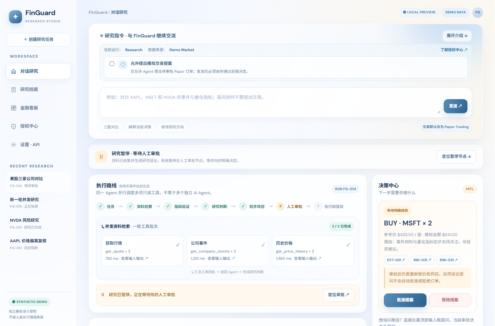
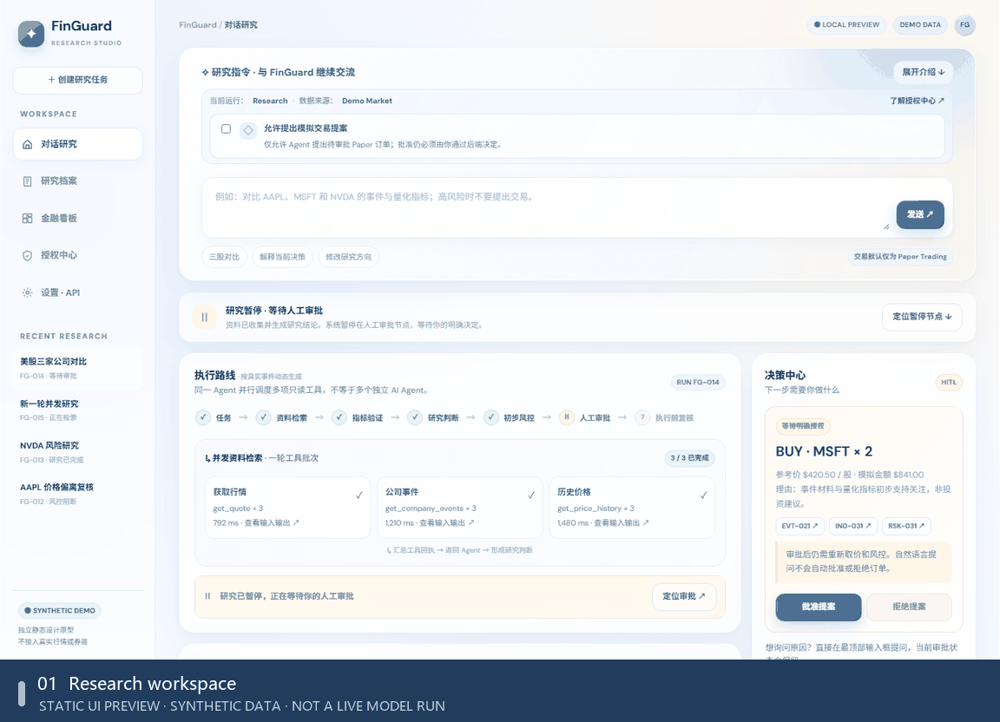
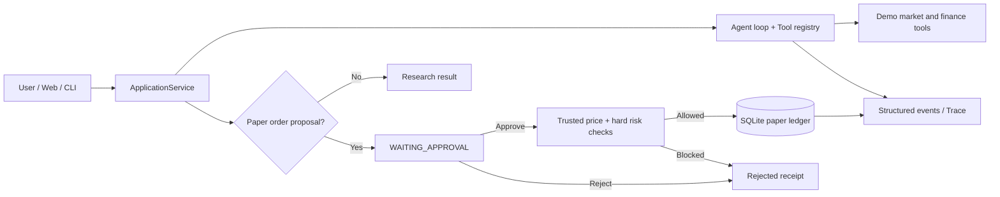

# FinGuard · Financial Research Agent

**A traceable, human-in-the-loop financial research Agent with a local paper-trading sandbox.**

FinGuard is a Python prototype exploring how AI can carry out a multi-step investment research workflow **without surrendering risk controls or execution authority to the model**. A user can ask a research question, inspect the Agent's tool calls and evidence, and explicitly approve or reject any *simulated* order proposal.

> **Project scope**: FinGuard is a locally runnable technical/product prototype, not an investment service. Demo prices/events are synthetic. **No real brokerage connection, no live orders, and no financial advice.** Auto Paper / automatic authorization in the interface is a future-design preview, **not an enabled capability**.

## Product preview



*FinGuard Research Studio v0.6 — **static interactive UI design preview**, showing a **synthetic** research session paused for human approval. The illustrated quotes, events, run IDs, portfolio and tool trace are fixtures; this screenshot is **not** a live LLM execution or an executed order.*

<details>
<summary><strong>▶ Watch the 16-second UI walkthrough (animated GIF)</strong></summary>



The GIF records actual navigation through the static interface, **not a recording of a real backend/LLM run**. The Authorization Center / Auto Paper screens are future-design previews, disabled in the current prototype.

</details>

**Explore the interface:** [Agent execution trace](docs/media/agent-trace.png) · [Research dossier and evidence](docs/media/evidence-library.png) · [Financial dashboard](docs/media/financial-dashboard.png) · [Authorization Center (preview only)](docs/media/authorization-center.png).

The locally runnable FastAPI + Python application provides real task and trace APIs, mock/demo market tools and approved **paper-only** actions as described below; the v0.6 mockup visualizes the intended product experience and includes design-only sections that are **not** wired to that application. See [UI/API mapping](web/UI_API_MAPPING.md) for integration boundaries.

## Why I built it

Most financial AI demos stop at a chat answer. I wanted to explore the more difficult product questions: What evidence supports a decision? How can a user see *which step* the Agent is on? Who is allowed to approve actions? And what happens if an Agent or the application stops halfway through a tool call?

This project focuses on **workflow orchestration, evidence traceability, deterministic risk checks and human oversight**, rather than return prediction.

## What works

| Area | Implemented in this repository |
| --- | --- |
| Research Agent | OpenAI-compatible chat-completions tool-calling loop with JSON Schema validation and structured tool errors |
| Finance tools | Demo quotes, events, price history, indicators and paper portfolio queries |
| Audit trail | Monotonic event sequence, per-run state, tool-call receipts and CLI/API event retrieval |
| Human approval | `propose_paper_order` pauses for explicit approve/reject; approval rechecks risk before simulated booking |
| Paper ledger | SQLite-backed cash / positions; idempotent approval processing and run recovery |
| Interfaces | FastAPI-served Research Workspace and CLI using the same application service |
| Reliability | Run leases, async dispatcher, restart/duplicate-request safeguards and automated tests |

**Boundaries:** demo market data is available offline; an external LLM needs a user-provided API key. Without a key, the smoke-test path uses a deterministic mock response, **not actual autonomous research**. Live-market integrations are not guaranteed in this release. This prototype is not configured for public hosting and has no production user-authentication layer.

## Product walkthrough

1. **Ask** a question, such as “Compare AAPL and MSFT using available tools; do not trade.”
2. **Research**: the backend creates a run, invokes the model and dispatches validated tool requests.
3. **Inspect**: the workspace exposes the task status, event timeline, research output and paper portfolio.
4. **Decide (optional)**: when paper proposals are enabled, the Agent may propose a simulated order, but **only the user can approve/reject it**. Before booking, the backend obtains a current trusted demo quote and re-evaluates deterministic risk rules.

### Architecture



See [technical design notes](docs/TECHNICAL_DESIGN.md) for state ownership, risk boundaries and run recovery.

## Run locally

**Requirements:** Python 3.11+; PowerShell examples below.

```powershell
git clone https://github.com/lifee3421/FinGuard.git
cd FinGuard
py -3 -m venv .venv
.\.venv\Scripts\Activate.ps1
python -m pip install -e ".[test]"
```

Start the workspace:

```powershell
python -m uvicorn finguard.interfaces.api:app --host 127.0.0.1 --port 8000
```

Open **http://127.0.0.1:8000/**. Keep the terminal open; the HTML interface expects this backend, rather than being a standalone static deployment.

Run from the CLI instead:

```powershell
python -m finguard.interfaces start "Compare AAPL and MSFT; do not trade"
python -m finguard.interfaces portfolio
python -m pytest -q
```

Demo mode requires no external market-data credentials. To run a **real LLM-powered** tool-calling workflow, copy `.env.example` to `.env` and configure `LLM_API_KEY`, `LLM_BASE_URL` and `LLM_MODEL` for an OpenAI-compatible model that supports tool calling. **Do not commit `.env`**. The default no-key execution is a safe mock/smoke test only.

For a paper-order proposal, use `--allow-paper-order-proposals` when starting a CLI run. The system will still require an explicit approval action; it never executes a real transaction.

## Testing and evidence

This recovered, independently checked source snapshot passed **65 tests** locally (Oct 16, 2026). The suite covers the Agent dispatcher, risk logic, persistence, idempotency, recovery, CLI/API adapters and overlapping HTTP requests. A **redacted** example trace from a real model-invocation research run is in [`examples/real_run_redacted.jsonl`](examples/real_run_redacted.jsonl). It contains demo-market tool calls and is not a record of real trading.

```powershell
python -m pytest -q
```

## Tech stack

`Python 3.11+` · `FastAPI` · `SQLite` · `asyncio` · `httpx` · `pytest` · `HTML/CSS/JavaScript`

## 中文简介

**FinGuard｜可审计的金融研究 Agent 与模拟交易工作台。** 项目围绕金融 AI 的可信执行展开：模型可调用行情、事件、技术指标等工具自主研究，但模拟订单必须经过人工审批，后端重新检查可信行情与硬性风控后才写入 SQLite 虚拟账本。提供研究过程 Trace、任务恢复、重复审批幂等保护，以及 Web/CLI 双入口。

**实现边界：** 无真实券商交易；默认离线演示数据；Auto Paper 为未开放设计，不能自动模拟交易；未配置模型 API 时仅运行 Mock，不等于真实 Agent 自主研究。

**Authorship:** Independent study and product/technical prototyping. AI coding assistance was used during development; product scoping, workflow design, integration and acceptance criteria were directed by the project author.
